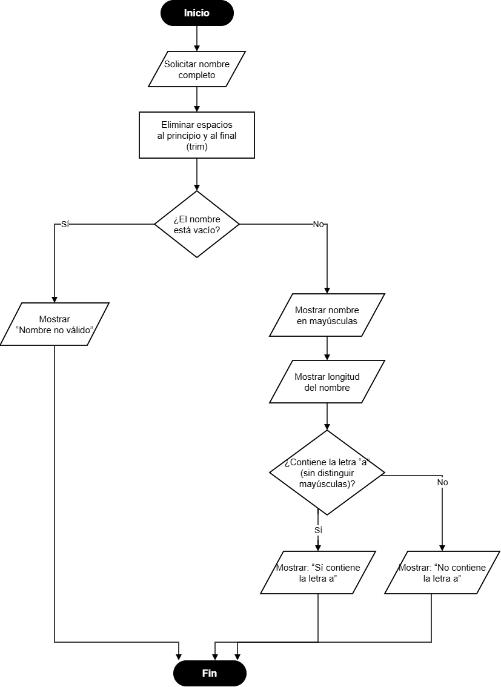
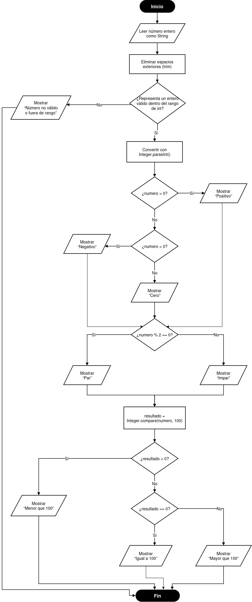
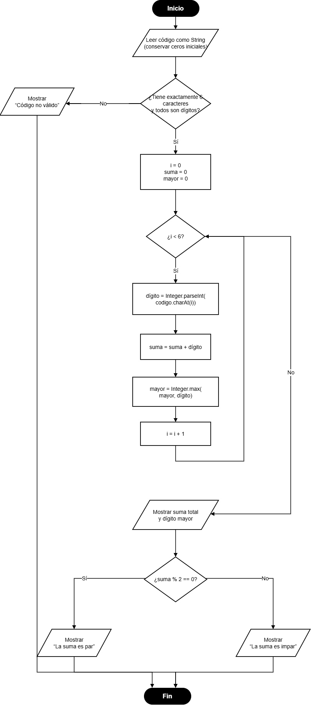

## Tarea evaluable 1:
## Ejercicio 1: Analizador de nombres
Enunciado: 
Solicitar el nombre completo del usuario como cadena de texto. Eliminar espacios al principio y al final, comprobar que el nombre no esté vacío y, si es válido, mostrarlo en mayúsculas, indicar su longitud y comprobar si contiene la letra `a` sin distinguir entre mayúsculas y minúsculas.

Diagrama de flujo:

## Ejercicio 2: 
Enunciado:

Diagrama de flujo:

## Ejercicio 3: 
Enunciado:

Diagrama de flujo:

